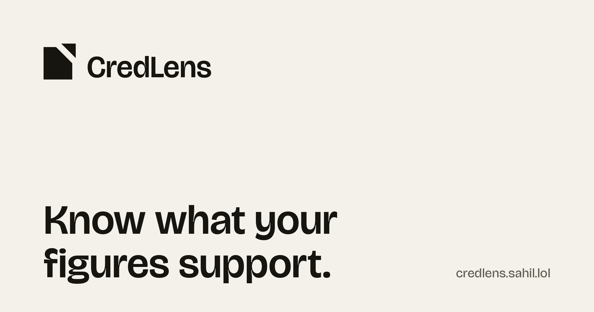
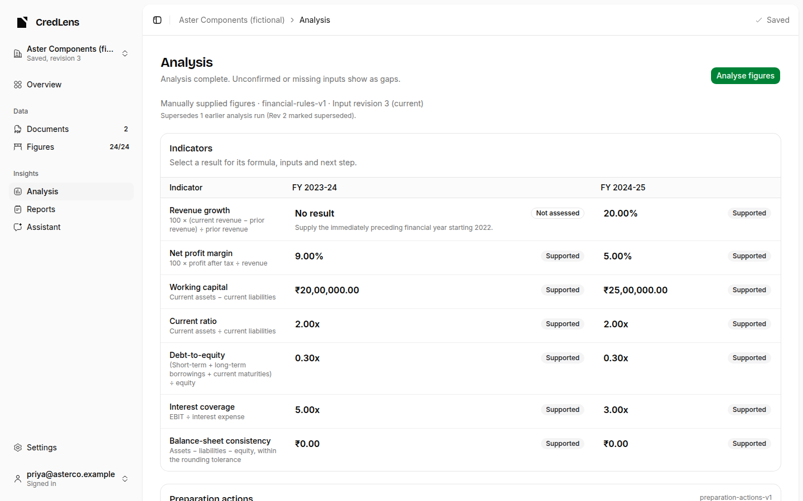
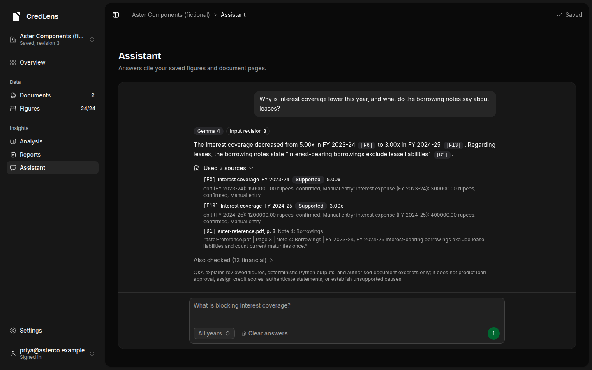

<p align="center">
  
  <br /><br />
  Financial-health checks for small manufacturing businesses in India before talking to an accountant or lender.
  <br />
  <a href="https://credlens.sahil.lol"><strong>credlens.sahil.lol</strong></a>
</p>

## What it does

- Accepts digital statement PDFs (balance sheet and profit and loss, up to 20 MB and 50 pages) or manual entry in a spreadsheet-style grid.
- Lets you check every extracted figure against its source PDF page before confirming it.
- Computes six indicators (revenue growth, net profit margin, working capital, current ratio, debt-to-equity, and interest coverage) plus a balance-sheet consistency check using deterministic Python `Decimal` arithmetic.
- Assigns each finding one of four evidence states (`Supported`, `Needs review`, `Not assessed`, or `Not meaningful`) so missing data blocks only the indicator that needs it.
- Generates a printable preparation report from saved analysis runs.
- Answers questions using Gemma 4 (`@cf/google/gemma-4-26b-a4b-it`) on Cloudflare Workers AI behind `worker/`. The backend verifies every figure and PDF page citation and falls back to a template answer when the model is unavailable. The assistant refuses loan-approval predictions, credit scores, authenticity claims, and forecasts.

## Screenshots

Captured using fictional Aster Components data.


| Analysis                                                                                                                 | Assistant                                                                                                      |
| ------------------------------------------------------------------------------------------------------------------------ | -------------------------------------------------------------------------------------------------------------- |
|  |  |

## Try it

Visit [credlens.sahil.lol](https://credlens.sahil.lol) and create an account with a password of 12 to 128 characters. There are no preset logins. You can also select **Continue as guest** for a browser-only demo loaded with the fictional Aster Components company where nothing is saved.

To try PDF extraction, upload `backend/tests/fixtures/pdf_corpus/aster-reference.pdf` first. All 24 figures extract automatically. Additional fictional statements are in `backend/tests/fixtures/eval_pack/`.

## Run locally

Copy `.env.example` to `.env.local`. Set `DATABASE_URL` and `DATABASE_URL_UNPOOLED` to a PostgreSQL 16+ database with the `vector` extension. Set `CREDLENS_AI_URL` and `CREDLENS_AI_TOKEN` for the assistant Worker, or set `CREDLENS_AI_DISABLED=1` for template-only answers.

```bash
# Backend setup, one-time embedding cache, and API server
cd backend
python3 -m venv .venv
.venv/bin/pip install -r requirements.txt
.venv/bin/alembic upgrade head
cd ..

backend/.venv/bin/python -c 'from sentence_transformers import SentenceTransformer; SentenceTransformer("sentence-transformers/all-MiniLM-L6-v2", device="cpu")'

cd backend
.venv/bin/python -m uvicorn app.main:app --host 127.0.0.1 --port 8000
```

```bash
# Frontend dev server in a second terminal (proxies /api to port 8000)
bun install
bun run dev

# Checks
bun test
bun run lint
bun run build
cd backend && .venv/bin/python -m pytest -q
```

## Deploy

Production runs as one Docker Compose stack on Coolify using `docker-compose.yml`, behind Cloudflare and Traefik. The `app` service uses the root `Dockerfile` to build the SPA with Bun and serve both the app and `/api` from FastAPI on port 8000. The `db` service runs `pgvector/pgvector:0.8.7-pg17`. Set `CREDLENS_AI_URL` and `CREDLENS_AI_TOKEN` in Coolify. Coolify generates the database credentials, and pushing to `main` redeploys automatically.

## Stack

- Frontend uses React 19, TypeScript, Vite, Tailwind CSS 4, shadcn/ui (Base UI), and Bun.
- Backend uses FastAPI, SQLAlchemy, Alembic, Python 3.14, and PostgreSQL 17 with pgvector.
- Extraction and AI use pdfplumber, local MiniLM (`sentence-transformers/all-MiniLM-L6-v2`) embeddings, and Gemma 4 on Cloudflare Workers AI.

## Limitations

- CredLens is not a lender decision or audit tool. It does not predict loan approval or eligibility, calculate credit or default scores, match lenders, forecast performance, or authenticate statements.
- The owner must review and confirm every extracted or entered figure. CredLens checks arithmetic and balance-sheet consistency rather than accounting accuracy.
- Scanned or image-only PDFs are not supported, and unsupported table layouts fall back to manual entry.
- Bank, GST, and credit-bureau connections, multiple currencies, and consolidated groups are out of scope.
- Financial rules remain provisional until an external finance reviewer validates them.
- Assistant questions send the current findings and authorised document excerpts to Cloudflare Workers AI unless `CREDLENS_AI_DISABLED=1` is set.

## Documentation

- [Project spec](docs/PROJECT_SPEC.md)
- [Financial contract](docs/FINANCIAL_CONTRACT.md)
- [Backend API and limits](backend/README.md)
- [Evaluation results](docs/EVALUATION_RESULTS.md)
- [Repository engineering rules](AGENTS.md)

Third-party notices are in [docs/third-party/](docs/third-party/).
