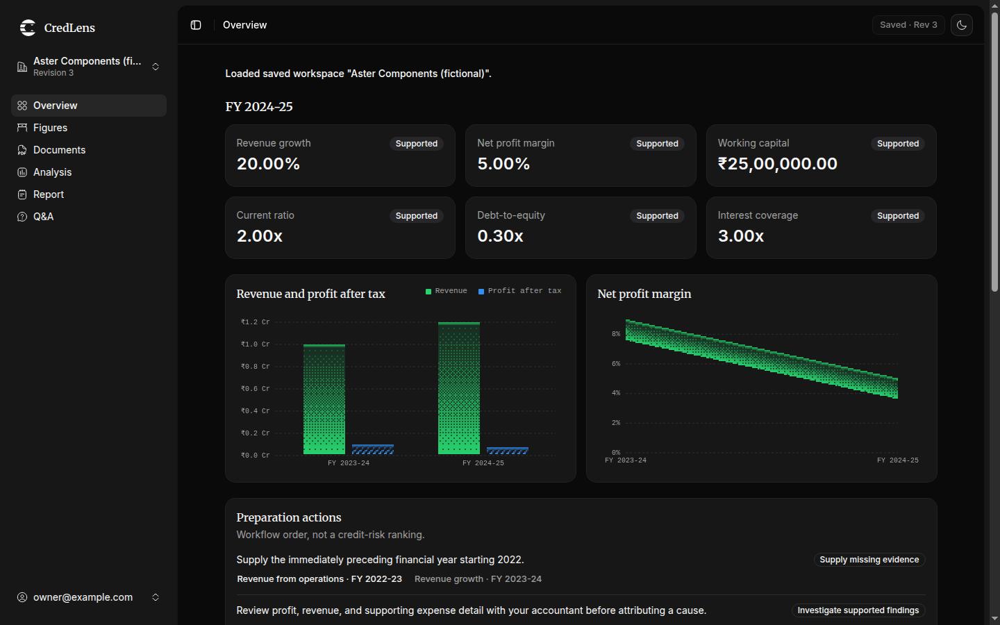
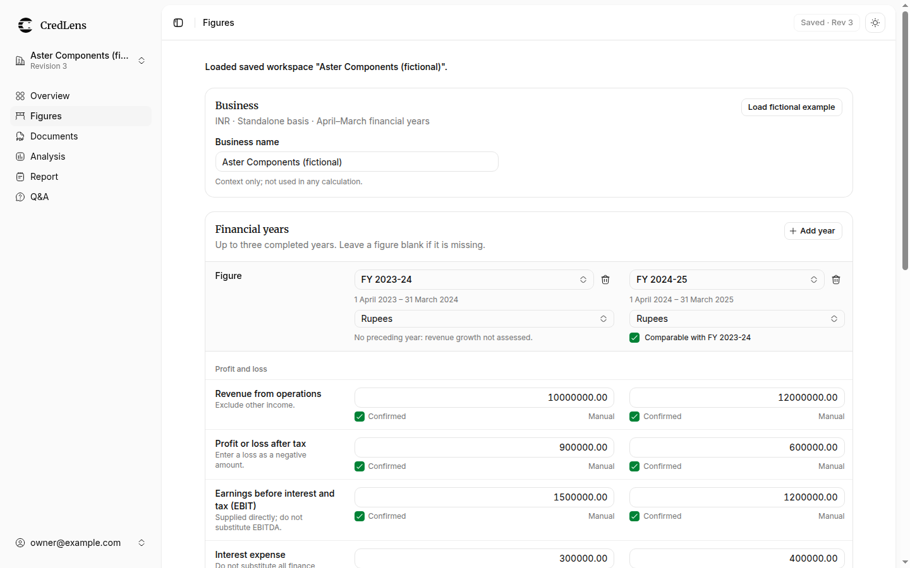
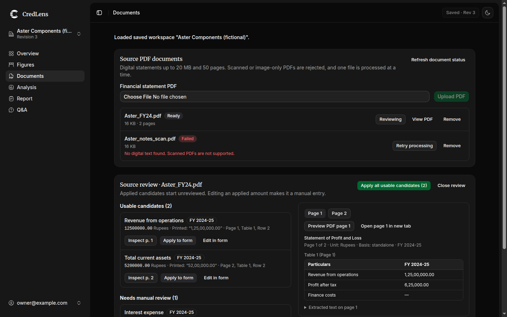

# CredLens

CredLens is a local-first financial-health and financing-readiness assistant for small manufacturing businesses with existing standalone financial statements (INR, April–March financial years, one to three completed periods). It connects **evidence to action**: every financial finding shows its reviewed inputs and origin (PDF page or manual entry), deterministic Python calculation (`financial-rules-v1`), explicit evidence state, and targeted preparation next step.

## Core capabilities

- **Dashboard interface (`src/app/`, `src/features/`):** shadcn `base-nova` sidebar shell with six sections (Overview, Figures, Documents, Analysis, Report, Q&A) on TanStack Router URLs, a sidebar workspace switcher and account menu, Light/Dark/System theme menu, an Overview with indicator cards, dither-kit trend charts and ordered preparation actions, and a year-by-figure entry grid. Sections stay mounted while you navigate, so drafts, answers and open reports survive switching.
- **Deterministic financial analysis (`backend/app/analysis.py`):** Exact Python `Decimal` (precision `34`, `ROUND_HALF_UP` display only) across six indicators — revenue growth, net profit margin, working capital, current ratio, debt-to-equity (excluding leases, counting current maturities once), and interest coverage (EBIT, never EBITDA) — plus balance-sheet consistency checks (`0.015 × unit_multiplier` INR rounding tolerance) and workflow-ordered preparation actions (`preparation-actions-v1`).
- **Four distinct evidence states:** `Supported`, `Needs review`, `Not assessed`, and `Not meaningful`, evaluated independently per indicator so missing or unreviewed inputs block only dependent calculations without turning missing data into an adverse credit judgement.
- **Owner-protected workspaces & revision history (`backend/app/auth.py`, `backend/app/persistence.py`):** Local FastAPI-managed accounts (`hashlib.scrypt` password hashing, SHA-256 hashed 7-day `HttpOnly` `SameSite=Lax` session cookies), optimistic concurrency (`PUT /api/businesses/{id}` with `expected_revision` / HTTP `409`), monotonic per-figure revisions, immutable `revisions` snapshots, and automatic supersession of outdated runs.
- **Bounded digital-PDF upload, candidate extraction & page-linked source review (`backend/app/documents.py`, `backend/app/pdf_worker.py`, `backend/app/pdf_extraction.py`, `src/features/documents/SourceReview.tsx`):**
  - Enforces 20 MB / 50-page limits, single active processing job per owner (PostgreSQL advisory lock + partial unique index), isolated local parser budgets (`15 s` wall / `10 s` CPU / `512 MiB` memory), encrypted/corrupted/scanned-only rejection, and interrupted-job reconciliation & retry.
  - Extracts unreviewed candidates (`document-extraction-v2`) for supported digital table layouts with exact page/table/row/column provenance; server verifies every `origin="document"` figure against owned ready snapshots; manual edits or year/unit changes convert figures to `origin="manual"`; deleting a PDF retains detached historical provenance (`Source PDF removed`).
- **Offline local retrieval & evidence-grounded Q&A (`backend/app/retrieval.py`, `backend/app/qa.py`, `src/features/qa/WorkspaceQA.tsx`):**
  - Period/page-aware chunks (`<= 220` WordPiece tokens), local CPU `sentence-transformers/all-MiniLM-L6-v2` embeddings (`384d`, `HF_HUB_OFFLINE=1`), and PostgreSQL `pgvector` cosine retrieval filtered strictly by `(owner_id, business_id, documents.status = 'ready')` before ranking.
  - Local loopback Ollama (`qwen3:4b-instruct`, rejecting remote hosts and `:cloud` tags) with `<untrusted_document_passage>` escaping, server-verified `[F#]`/`[D#]` citations, lending/scoring/read-only guardrails, and automatic deterministic template fallback when Ollama is unavailable.
- **Printable versioned preparation reports (`backend/app/reports.py`, `src/features/reports/PreparationReport.tsx`):** Native browser `@media print` reports backed by immutable `analysis_runs` snapshots with `CURRENT VERSION` vs. `SUPERSEDED` banners, missing-evidence tables, ordered actions, referenced documents, and limitations.
- **Active-data deletion & minimal audit log (`backend/app/documents.py`, `backend/app/audit.py`):** Staged workspace deletion (`DELETE /api/businesses/{id}`) removes local `.pdf`/`.tmp` files and cascades across all workspace/figure/revision/run/document/chunk tables while recording a minimal scalar-only `audit_events` entry (`GET /api/audit-events`, zero financial payloads) and disclosing database backup-retention limits.

## Screenshots

Fictional Aster Components data; captured from `vite preview` with mocked API responses.

| Overview (dark) | Figures (light) |
| --- | --- |
|  |  |
| **Documents and source review (dark)** | **Analysis (light)** |
|  |  |

## Reproducible local setup (clean clone)

### Prerequisites

- **Node.js / Bun:** Bun `1.4+` (preserves `bun.lock`)
- **Python:** Python `3.12+` with `venv` and `pip`. On Debian-based systems, install the matching `venv` package if Python reports that `ensurepip` is unavailable.
- **PostgreSQL 16+ with `pgvector` (`vector` extension):** Local PostgreSQL or Neon PostgreSQL (`DATABASE_URL` and direct `DATABASE_URL_UNPOOLED`)
- **Local LLM (optional for fallback mode; required for live local Q&A):** Ollama `v0.40.16+` ([ollama.com](https://ollama.com))

### 1. Configure database environment

Create `.env.local` in the repository root using [.env.example](.env.example) and the [backend setup notes](backend/README.md).

```bash
DATABASE_URL="postgresql://<user>:<password>@<host>/<db>?sslmode=require"
DATABASE_URL_UNPOOLED="postgresql://<user>:<password>@<direct-host>/<db>?sslmode=require"
```

### 2. Install backend dependencies and run migrations

```bash
cd backend
python3 -m venv .venv
.venv/bin/pip install -r requirements.txt
.venv/bin/alembic upgrade head
cd ..
```

*(On Windows PowerShell, replace `.venv/bin/` with `.venv\Scripts\`.)*

### 3. Pre-cache local models once (for offline operation afterward)

```bash
# 1. Cache sentence-transformers/all-MiniLM-L6-v2 (~91 MB, CPU, Apache-2.0)
backend/.venv/bin/python -c 'from sentence_transformers import SentenceTransformer; SentenceTransformer("sentence-transformers/all-MiniLM-L6-v2", device="cpu")'

# 2. Pull local instruction model (~2.5 GB, Apache-2.0; start `ollama serve` first)
OLLAMA_HOST=127.0.0.1:11434 ollama serve &
ollama pull qwen3:4b-instruct
```

After this one-time download, CredLens runs embeddings with `HF_HUB_OFFLINE=1` / `TRANSFORMERS_OFFLINE=1` / `local_files_only=True` and calls Ollama strictly on `http://127.0.0.1:11434`.

### 4. Install frontend dependencies and start all local services

Run in separate terminals from the repository root:

```bash
# Terminal 1 — Local Ollama (optional; omit to exercise template fallback)
OLLAMA_HOST=127.0.0.1:11434 OLLAMA_NO_CLOUD=1 ollama serve
```

```bash
# Terminal 2 — FastAPI backend
cd backend
.venv/bin/python -m uvicorn app.main:app --host 127.0.0.1 --port 8000
```

```bash
# Terminal 3 — Vite frontend (proxies /api -> http://127.0.0.1:8000)
bun install --frozen-lockfile
bun run dev
```

Open the URL Vite prints (typically `http://127.0.0.1:5173`).

## Live demonstration walkthrough

This sequence reproduces every item in the [Final demonstration checklist](docs/PROJECT_SPEC.md#final-demonstration-checklist) using the included fictional Aster Components PDFs (`backend/tests/fixtures/pdf_corpus/aster-reference.pdf`):

Navigate with the sidebar sections; workspace switching, **New workspace** and **Delete workspace** live in the sidebar workspace menu, **Sign out** in the account menu, and **Save workspace** in the top bar.

1. **Create account & workspace:** On **Overview**, register a local account. On **Figures**, enter `Aster Components (fictional)` as the business name and click **Save workspace** in the top bar.
2. **Upload PDF & inspect source:** On **Documents**, upload `backend/tests/fixtures/pdf_corpus/aster-reference.pdf`, click **Review extracted figures**, inspect a source cell (`Inspect p. 2`), and click **Apply all usable candidates (24)**. On **Figures**, toggle comparability for FY 2024-25 and click **Confirm present figures**. On **Analysis**, click **Analyse figures** → shows net profit margin moving from `9.00%` (FY 2023-24) to `5.00%` (FY 2024-25) with `Document: aster-reference.pdf · p. 1` citations and `financial-rules-v1`.
3. **Correct one extracted value at its source:** Edit FY 2024-25 `Interest expense` from `400000.00` to `300000.00` → figure converts immediately to `Manual` (unreviewed). Confirm and re-analyse → interest coverage updates from `3.00x` to `4.00x` and the earlier run is marked superseded.
4. **Selective missing-input blocking:** Clear FY 2024-25 `Interest expense`, save, and re-analyse → `Interest coverage` displays `Not assessed` and requests interest expense while the five unrelated indicators remain `Supported`.
5. **Versioned printable report & supersession:** On **Report**, open the preparation report marked `CURRENT VERSION`. Restore and confirm FY 2024-25 interest expense, then analyse again and open the refreshed current report. Open the earlier report to see `SUPERSEDED`. Print either version using **Print / Save as PDF**. Report version numbers follow saved analysis history.
6. **Evidence-grounded Q&A & refusals:** On **Q&A**, ask *"What do the borrowing notes say about leases?"* (returns `[D#]` page 3 citation) and *"Will a bank approve my INR 50 lakh loan?"* (refuses without inventing approval odds or credit scores). Stop Ollama to verify immediate deterministic template fallback.
7. **Cross-business isolation & active-data deletion:** Verify a second account receives HTTP `404` on the first account's business/document/report IDs. Choose **Delete workspace** in the sidebar workspace menu → confirm the backup-retention disclosure → deletes local PDFs and all derived database records while keeping a minimal `workspace_deleted` entry in the Overview **Activity log**.

## Verification and evaluation commands

| Check | Command |
| --- | --- |
| Backend offline suite (`204` pass / `37` live skips) | `cd backend && .venv/bin/python -m pytest -q` |
| Backend dependency integrity | `cd backend && .venv/bin/pip check` |
| Schema consistency check | `cd backend && .venv/bin/alembic check` |
| Live Neon tests (use a **disposable** direct branch URL only) | `cd backend && PERSISTENCE_TEST_URL="<direct-disposable-url>" .venv/bin/python -m pytest -q` |
| Frontend unit & Python-integration tests (`46` pass) | `bun test` |
| Headless browser UI checks (`64` checks) | `bun tests/run-workspace-ui.ts /path/to/chromium-or-chrome` |
| Frontend lint & production build | `bun x oxlint src/ tests/ && bun run build` |
| Reproduce frozen P5-03 evaluation pack hashes | `backend/.venv/bin/python backend/tests/build_eval_pack.py` |
| Re-run P5-04 A/B/C ablation (requires local Ollama running) | `backend/.venv/bin/python backend/tests/run_p504_evaluation.py --output /tmp/credlens-evaluation.json` |

*Cached/recorded output notice:* [docs/eval_p504_results.json](docs/eval_p504_results.json) and [docs/EVALUATION_RESULTS.md](docs/EVALUATION_RESULTS.md) record the frozen `2026-11-21` P5-04 evaluation run (180 live local `qwen3:4b-instruct` calls + separate raw PDF extraction across 4 evaluation PDFs and 1 held-out Layout C PDF). On the 60-question benchmark, Full CredLens (Variant C) achieved **`44/60` (`73.33%`)** strict automated pass / **`54/60` (`90.00%`)** proxy-audited useful coverage (`12/12` numerical, `21/24` blocked analyses, `0/48` false refusals) versus Basic RAG **`18/60` (`30.00%`)** and RAG + naive calculations **`32/60` (`53.33%`)**.

The Phase 5 closeout reran the same frozen questions with a stricter check for expected page citations. Full CredLens passed 60/60, including 24/24 blocked findings and 12/12 refusal cases. These are regression results on the known fixtures. Use a new output path for each rerun to preserve the recorded results. [Closeout measurements](docs/eval_p504_closeout_results.json)

## Frozen dependency and model versions

| Layer | Component | Pinned version / digest | License |
| --- | --- | --- | --- |
| Frontend | React / Vite / TypeScript / Tailwind CSS | `19.3.1` / `8.3.6` / `~7.0.2` / `4.3.5` (`bun.lock`) | MIT / Apache-2.0 |
| Frontend UI | `@base-ui/react` / `shadcn` (`base-nova`) / Hugeicons | `1.9.0` / `4.23.0` / `1.1.10` | MIT |
| Frontend routing & charts | `@tanstack/react-router` / dither-kit (vendored in `src/components/dither-kit/`) / `motion` / `d3-scale` / `d3-shape` | `1.170.46` / registry snapshot 2026-11-25 / `14.14.0` / `4.0.3` / `3.2.1` | MIT / ISC |
| Backend API | FastAPI / Pydantic / Uvicorn / SQLAlchemy / Alembic / Psycopg | `0.162.2` / `2.14.3` / `0.54.0` / `2.1.8` / `1.20.1` / `3.3.9` | MIT / LGPL / BSD |
| PDF & Vector | `pdfplumber` / `pgvector` (Python) / PostgreSQL `vector` | `0.11.10` / `0.5.1` / `0.8.7` | MIT / PostgreSQL |
| Local embeddings | `sentence-transformers` / `torch` (CPU) / `all-MiniLM-L6-v2` | `6.3.0` / `2.15.0+cpu` / rev `1110a243fdf4` (`384d`, `256` tok) | Apache-2.0 / BSD |
| Local LLM | Ollama / `qwen3:4b-instruct` (`Q4_K_M`, 4.02B params) | `v0.40.16` / digest `0edcdef34593` (`num_ctx=4096`) | MIT / Apache-2.0 |

Full transitive pins live in [backend/requirements.txt](backend/requirements.txt) and [bun.lock](bun.lock).

## Known limitations and out-of-scope boundaries

- **Not a lending decision or audit tool:** CredLens does not predict loan approval or eligibility, compute credit/default scores, match lenders, connect to bank/GST/bureau APIs, forecast future performance, or authenticate financial statements.
- **Provisional financial rules (`D-02`):** Formula definitions and sample findings remain provisional pending external licensed finance-reviewer validation.
- **Evaluation pack scope (`D-05`):** The frozen `eval-pack-v1` benchmark covers four fictional manufacturing businesses and one held-out Layout C business. The HUL standalone excerpts remain deferred. The closeout used agent review of fictional records. External business-owner usability and finance review remain open.
- **Limited PDF layout support:** `pdf-extraction-v2` targets 1–2 annual amount-column digital tables with explicit standalone/unit/period headings; 3-column tables, unseen layouts (e.g. held-out Layout C), and scanned/image-only PDFs fall back safely to manual entry (`0` wrong matches in P5-04).
- **Q&A coverage:** The closeout exercised the original three-year prompt, citation, evidence-state, and lending-refusal cases on the frozen set. The measured results apply to those fixtures and model settings. [Evaluation results](docs/EVALUATION_RESULTS.md)
- **Backup & deployment boundaries:** Deleting a workspace removes active local files and database records immediately, but cannot erase managed PostgreSQL point-in-time recovery backups before provider retention expiry. Local development uses HTTP on loopback; require HTTPS before any non-local pilot.

## Project documentation

- [docs/PROJECT_SPEC.md](docs/PROJECT_SPEC.md) — Living phased spec, verified baseline, decisions, and full task log
- [docs/FINANCIAL_CONTRACT.md](docs/FINANCIAL_CONTRACT.md) — Confirmed financial rules, signs, rounding, tolerance, and evidence-state precedence
- [docs/PERSISTENCE_PLAN.md](docs/PERSISTENCE_PLAN.md) — PostgreSQL schema, auth/session policy, revisions, documents, retrieval, and audit log
- [docs/EXTRACTION_PLAN.md](docs/EXTRACTION_PLAN.md) — Digital-PDF extraction scope, corpus integrity, and v1/v2 measurements
- [docs/LOCAL_MODEL_TRIAL.md](docs/LOCAL_MODEL_TRIAL.md) — Host hardware measurements, offline model settings, and fallback policy
- [docs/EVALUATION_RESULTS.md](docs/EVALUATION_RESULTS.md) — P5-04 separate extraction results, A/B/C 60-question ablation, and failure analysis
- [docs/CONTRIBUTION_LOG.md](docs/CONTRIBUTION_LOG.md) — Repository commit and milestone contribution log
- [backend/README.md](backend/README.md) — Backend API routes, limits, and Neon setup notes
- [AGENTS.md](AGENTS.md) — Repository engineering rules (with [Ponytail MIT license](docs/third-party/ponytail-LICENSE.txt))
